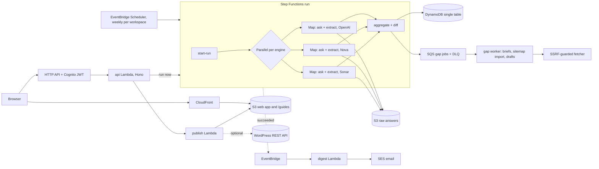

# AnswerShare

Track and improve your brand's place in AI answers, on AWS.

AnswerShare asks AI answer engines the questions buyers ask just before they compare tools, records which brands each answer names, in what order, and which pages it cites. It shows where your site is missing or weaker than the sources the engines trust, gives you a brief and a draft for the page that fills the gap, and marks the publish date on later runs so you can see whether it changed anything.

> Your brand is never in the prompt. Every rate comes with its sample size. Nothing is published without a human click.



## How it works

1. **Prompts.** You track 10 to 50 buyer questions per workspace, tagged problem, solution or comparison. Any prompt that names your brand, an alias or your domain is rejected. Nova can suggest prompts from your homepage and sitemap.
2. **Runs.** Weekly (or on demand), `start-run` builds `prompt x engine x sample` work items and refuses the run if it exceeds `MAX_CALLS_PER_RUN`. Each engine gets its own inline Map with its own concurrency (OpenAI 5, Nova 5, Sonar 3), so one provider's rate limit does not slow the others. 429 and 5xx errors retry with jittered backoff; an item that still fails is recorded as failed and the run carries on.
3. **Asking.** The prompt is sent exactly as a buyer would type it, with no system prompt about brands: the OpenAI Responses API with `web_search`, Nova 2 Lite with the `nova_grounding` system tool on Bedrock, and Perplexity Sonar. Raw responses go to `s3://raw/<runId>/<promptId>/<engine>/<n>.json`.
4. **Extraction.** Nova 2 Lite reads each answer through a strict tool schema (brands in order, recommended, sentiment). A deterministic matcher maps names to your brand and competitors using aliases and domains, and decides the order. When the two disagree the answer is flagged in the UI.
5. **Aggregate.** Rollups per prompt and engine, per engine, and for the workspace; a diff against the previous run (lost and gained mentions, new brands); and gap candidates: prompts where you are missing in at least 2 of 3 samples on any engine, or where your domain is never cited.
6. **Gaps.** Each candidate becomes a job on SQS. The worker reads the top 3 cited pages and your 3 closest pages through the guarded fetcher, then Nova writes a brief: what the sources cover that you do not, improve or new page, page type, outline, questions to answer word for word, and a facts checklist where every product fact is a `[fill in]` placeholder.
7. **Publish.** A draft is written from the brief and edited in the browser. Publishing is blocked until every `[fill in]` is resolved, and always takes a click. Hosted guides go to `/guides/<slug>/` with Article and FAQPage JSON-LD, plus a regenerated `sitemap.xml`, `llms.txt` and `robots.txt`; WordPress is optional. The crawler check warns if `robots.txt` blocks `OAI-SearchBot`, `PerplexityBot` or `GPTBot`.
8. **Measure.** Published posts are linked to their prompts, and trend charts mark the publish date. A digest email goes out when each run finishes.

## Design decisions

- **Rates, never single answers.** Answers vary from call to call, so every prompt is sampled (default 3) and every rate is shown as `n/N`. The dashboard draws one dot per answer.
- **Idempotent by key.** An answer's key is `runId + promptId + engine + sample` and writes are conditional. A retried or replayed ask skips the paid call if the slot already holds an answer; a failed slot can be overwritten by a later success.
- **Two readers for extraction.** The LLM is good at "recommended" and sentiment; the matcher is predictable about aliases and order. Both are stored and disagreements are surfaced instead of hidden.
- **Fetched pages are untrusted.** The fetcher allows only http(s) on ports 80 and 443, checks every resolved address and every redirect hop against private, loopback, link-local and metadata ranges (including IPv4-mapped IPv6 and decimal or hex IP forms), caps pages at 2 MB after decompression, 10 s and 3 redirects, sends an honest user agent and respects `robots.txt`. Page text reaches the model only as quoted data, and the brief call has no tools.
- **No invented facts.** Briefs and drafts may only use `[fill in]` for product facts, and three layers (editor, API, publish Lambda) refuse to publish while one remains.
- **Idle cost near zero.** No VPC, NAT, OpenSearch or provisioned capacity; on-demand DynamoDB; API keys in SSM SecureString instead of Secrets Manager; logs kept 7 days.

## Single-table design

Table `answershare`, on demand, `PK`/`SK`, one GSI (`GSI1PK`/`GSI1SK`), TTL on `expiresAt`. Raw answers and page text live in S3.

| Entity | PK | SK | GSI1PK / GSI1SK |
| --- | --- | --- | --- |
| Workspace | `WS#<ws>` | `META` | `USER#<sub>` / `WS#<ws>` |
| Competitor | `WS#<ws>` | `COMP#<slug>` | |
| Prompt | `WS#<ws>` | `PROMPT#<promptId>` | |
| Run | `WS#<ws>` | `RUN#<runId>` (run ids start with their UTC start time, so they sort) | |
| Answer | `RUN#<runId>` | `ANS#<promptId>#<engine>#<n>` | `PROMPT#<promptId>` / `<ts>#<engine>#<n>` |
| Metric rollup | `WS#<ws>` | `MET#<promptId>#<engine>#<ts>` | workspace rollups only: `WS#<ws>#MET` / `<ts>#<engine>` |
| Untracked brand | `WS#<ws>` | `BRAND#<slug>` | |
| Own page | `WS#<ws>` | `PAGE#<urlHash>` | |
| Gap | `WS#<ws>` | `GAP#<promptId>` | `WS#<ws>#GAP#<status>` / `<score>` |
| Post | `WS#<ws>` | `POST#<postId>` | `WS#<ws>#POST#<status>` / `<ts>` |
| Post-prompt link | `WS#<ws>` | `LINK#<promptId>#<postId>` | |

Answers keep their text (capped at 20k characters), mentions and citations, and expire after 180 days; rollups keep the history.

| # | Access pattern | How |
| --- | --- | --- |
| 1 | Get a workspace; list a user's workspaces | `GetItem`; GSI1 `USER#<sub>` |
| 2 | Competitors and prompts | `PK` + `begins_with` |
| 3 | Runs, newest first | `PK` + `begins_with RUN#`, reverse |
| 4 | All answers in a run | `PK RUN#<id>` |
| 5 | One prompt's answers across runs | GSI1 `PROMPT#<id>`, reverse |
| 6 | Trend for a prompt | `PK` + `begins_with MET#<promptId>#` |
| 7 | Workspace trend between dates | GSI1 `WS#<ws>#MET` between two timestamps |
| 8 | Open gaps by score | GSI1 `WS#<ws>#GAP#open`, reverse |
| 9 | Drafts and published posts | GSI1 `WS#<ws>#POST#<status>` |
| 10 | Posts linked to a prompt (chart markers) | `PK` + `begins_with LINK#<promptId>#` |

## Stack

| Folder | What |
| --- | --- |
| `infra/` | CDK app: one stack built from `storage`, `run`, `gaps`, `web`, `publish` and `monitoring` constructs |
| `backend/` | Lambdas (`run-*`, `gap-worker`, `api`, `publish`, `digest`), engines, extraction, fetcher, data access, scripts and tests |
| `client/` | React + Vite app: dashboard, who comes up, gaps, briefs, editor, settings |
| `scripts/` | `set-keys.sh`, `redrive.sh`, `teardown.sh` |

TypeScript end to end, Node.js 24 on arm64, Step Functions, SQS, Bedrock (Nova 2 Lite), DynamoDB, S3, CloudFront, Cognito, SES. Region `us-east-1`, because Nova Web Grounding runs only in US regions.

## Quick start

Prerequisites: an AWS account in `us-east-1` with CDK bootstrapped; Bedrock access to Nova 2 Lite and the Nova grounding system tool (any SCP must allow `aws:RequestedRegion = unspecified`); an SES-verified sender; an OpenAI API key and, optionally, a Perplexity key; Node.js 24.

```bash
npm run install:all
cp infra/.env.example infra/.env        # set ALERT_EMAIL (and DIGEST_FROM if different)
npm run infra:deploy                    # builds the client and deploys; writes infra/cdk-outputs.json
npm run keys:set                        # OpenAI, Perplexity and WordPress keys into SSM
npm run add-user -- you@example.com     # invite-only sign in; prompts for a password
npm run run:now -- "What's the easiest way to invoice international clients?" --engines nova --brand "Acme Pay"
npm run smoke                           # 5 prompts x 3 engines x 1 sample against real APIs, about $0.50
```

Then open the `SiteUrl` output, create a workspace, add competitors and prompts (or let it suggest some), import your sitemap and press Run now. Engines without a key are skipped and listed on the run. For free end-to-end runs, choose the `fake` engine in settings.

Local development: `npm run client:config` writes `client/public/config.json` from the deployed stack, then `npm run client:dev` (and optionally `npm run api:dev`).

## Tests

```bash
npm run typecheck
npm run backend:test     # offline: keys, prompts, engines, matcher, metrics, extraction eval, fetcher, suggestions, gaps, publishing, digest
npm run infra:test       # synthesizes the stack and asserts on the template
npm run test:live        # against the deployed stack: foundation, pipeline, API, gaps, publishing (about $0.05 in Nova calls)
```

- **Extraction eval:** 20 hand-labelled answers in `backend/test/fixtures/labelled/`. The suite fails if brand recall drops below 95% or position accuracy below 90%. `npm --prefix backend run test:eval:live` runs the same set through Nova as well.
- **Engine adapters:** recorded response fixtures for OpenAI, Nova (both documented citation shapes) and Sonar, plus 429, 5xx, 4xx and network error mapping.
- **Fetcher security:** private, loopback, link-local and metadata addresses, decimal and hex IP forms, IPv4-mapped IPv6, redirects to metadata IPs and non-http schemes, oversize bodies, slow pages and `robots.txt`.
- **Pipeline (live, fake engine):** a 10-prompt run produces rates with sample sizes, forced failures do not fail the run, replaying an ask creates no duplicate, a run over the cap is refused, and gap jobs are queued.
- **Publishing:** script, image, attribute and `javascript:` injection in Markdown, JSON-LD that parses and cannot close its script tag, sitemap, `llms.txt`, robots, slug clashes and the placeholder block; live, a guide is drafted, blocked, published to CloudFront, checked and unpublished.
- **Infra:** arm64 and Node 24 everywhere, 7-day logs, nothing retained after `cdk destroy`, no wildcard resources on data, Bedrock and SSM scoped to exact ARNs, invite-only Cognito, JWT on every route but `/health`, strict CSP on the app and a no-script CSP on guides, DLQ and alarms.

## Costs

Third-party price lists used for the estimate (check each provider's official page before relying on them):

| Item | Price used |
| --- | --- |
| OpenAI `web_search` | $10 per 1,000 searches plus tokens; one question can trigger several searches |
| Nova Web Grounding | $30 per 1,000 grounded requests plus tokens |
| Nova 2 Lite tokens | $0.30 / M input, $2.50 / M output |
| Perplexity Sonar | $5 to $12 per 1,000 requests plus $1 / M tokens |

A default run is 25 prompts x 3 engines x 3 samples = 225 answers:

| Line | Estimate per run |
| --- | --- |
| OpenAI (75 answers, 1 to 3 searches each) | about $1 to $3 |
| Nova grounded (75 requests) | about $2.45 |
| Sonar (75 requests) | about $0.50 to $1.05 |
| Extraction (225 answers on Nova 2 Lite) | about $0.34 |
| Step Functions, Lambda, DynamoDB, S3 | under $0.05 |
| **Total** | **about $4.30 to $6.90** |

Weekly that is roughly $19 to $30 a month; idle is about $0. A gap brief costs about $0.01 and a draft about $0.02.

**Measured.** Every run stores its measured cost (search calls and tokens per engine plus extraction), shown on the dashboard and in the digest. Runs on the `fake` engine measured $0.00. No real-engine run has been recorded in this README yet: run `npm run smoke` once keys are set and replace this paragraph with its `cost` output.

## API

All routes except `/health` need a Cognito ID token; every workspace route returns 404 to anyone but the owner.

| Method | Path | Purpose |
| --- | --- | --- |
| `GET` / `POST` | `/workspaces` | List and create workspaces |
| `GET` / `PUT` | `/workspaces/:ws` | Read and update settings (engines, samples, schedule, WordPress, digest) |
| `PUT` | `/workspaces/:ws/competitors` | Replace the competitor list (up to 10) |
| `POST` | `/workspaces/:ws/prompts` | Add a prompt (rejected if it names your brand) |
| `PUT` / `DELETE` | `/workspaces/:ws/prompts/:id` | Edit, pause or delete a prompt |
| `POST` | `/workspaces/:ws/prompts/suggest` | Suggest prompts from your site |
| `GET` | `/workspaces/:ws/prompts/:id/answers?runId` | Who comes up for one prompt |
| `GET` | `/workspaces/:ws/prompts/:id/trend` | Per-prompt trend and publish links |
| `POST` | `/workspaces/:ws/prompts/:id/gap` | Refresh the gap brief for a prompt |
| `POST` / `GET` | `/workspaces/:ws/runs` | Run now (1 per hour, capped) and list runs |
| `GET` | `/workspaces/:ws/runs/:runId` | Run status, counts and measured cost |
| `GET` | `/workspaces/:ws/visibility?from&to&engine` | Dashboard trend, latest run and publish markers |
| `GET` | `/workspaces/:ws/brands` | Brands in answers that you do not track |
| `GET` | `/workspaces/:ws/gaps?status` | Gaps by score |
| `GET` | `/workspaces/:ws/gaps/:id` | Brief and evidence |
| `POST` | `/workspaces/:ws/gaps/:id/dismiss`, `/reopen`, `/draft` | Change status or start a draft |
| `POST` / `GET` | `/workspaces/:ws/sitemap/import`, `/workspaces/:ws/pages` | Import and list your pages |
| `GET` / `PUT` | `/workspaces/:ws/posts`, `/workspaces/:ws/posts/:id` | List, read and edit drafts |
| `POST` | `/workspaces/:ws/posts/:id/publish`, `/unpublish` | Publish to `/guides` or WordPress, or take down |
| `GET` | `/workspaces/:ws/crawler-check?target` | Check `robots.txt` for AI search crawlers |

## Cost guardrails

- `MAX_CALLS_PER_RUN` (default 300) refuses oversized runs before any engine is called; manual runs are limited to one per hour per workspace.
- Every run records search calls and tokens per engine, so the cost meter counts real `web_search_call` items, not prompts.
- An AWS Budgets alert at $30 a month (80% actual, 100% forecast) filtered on the `project=answershare` cost allocation tag. Set spend limits in the OpenAI and Perplexity consoles too.
- CloudWatch alarms email you when gap jobs land in the DLQ, when a run fails, times out or is aborted, and when the API or publisher keeps erroring. `npm run dlq:redrive` moves DLQ jobs back once fixed.

## Known limits

- **API answers are not ChatGPT app answers.** The consumer apps add memory, personalization, location and their own routing. AnswerShare measures the APIs with web search: a good indicator, not the same thing. The UI says so on every answer page.
- **Answers vary.** Small prompt sets with one sample give noisy trends.
- **Publishing will not move results quickly.** Engines must crawl and index a page first, so expect weeks. The before/after chart is honest measurement, not proof of cause.
- **Nova grounding is US-only** and uses `requestedRegion = unspecified`, which strict SCPs can block. It is an AWS engine, not a consumer product: treat it as one more signal.
- **Extraction can misread** ("unlike Acme" is a mention, not a recommendation). Disagreements between the two readers are flagged, and the labelled eval keeps regressions visible.
- **Search fees can surprise you.** OpenAI may search several times for one question; each is billed and counted.
- **Gap briefs read competitors' pages** to see what is missing; they summarize, and drafts never copy their text.
- **One owner per workspace.** No teams or billing in v1.

## Build log

| Phase | What |
| --- | --- |
| 1 | Foundation and engines: table, raw bucket, SSM keys, OpenAI, Nova and Sonar adapters, fake engine, `run:now` |
| 2 | Runs and extraction: Step Functions with per-engine Maps, Nova extraction plus matcher, metrics, diff, weekly schedules, run cap |
| 3 | Web app: Cognito, Hono API with ownership checks, guarded fetcher, prompt suggestions, dashboard and who comes up |
| 4 | Gap finder: SQS and DLQ, gap worker, sitemap import, briefs with `[fill in]` facts, scores |
| 5 | Publishing: drafts, editor, hosted `/guides` with JSON-LD, sitemap and `llms.txt`, WordPress, crawler check, publish markers |
| 6 | Hardening: budget, alarms, DLQ redrive, run digest by SES, smoke run, teardown |

## Tear down

```bash
npm run teardown    # cdk destroy, then deletes the SSM keys, leftover Lambda log groups and local outputs
```

Everything the stack creates (table, buckets, schedules, queues, user pool, logs) is removed with it.
